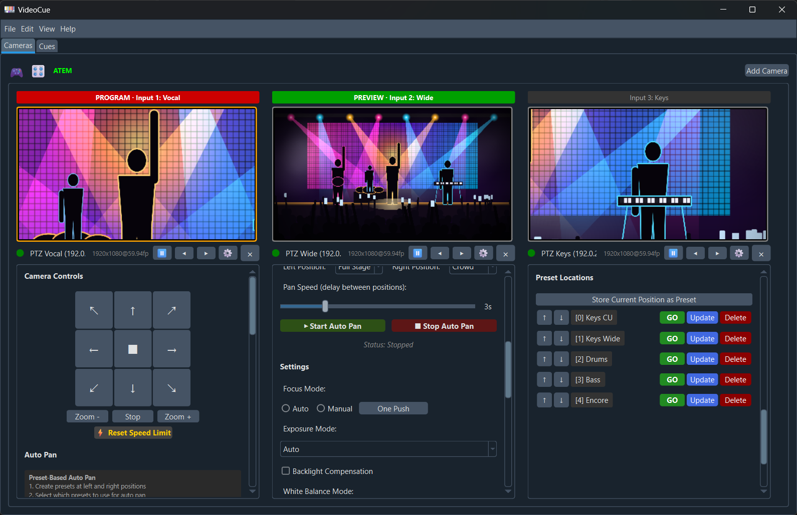
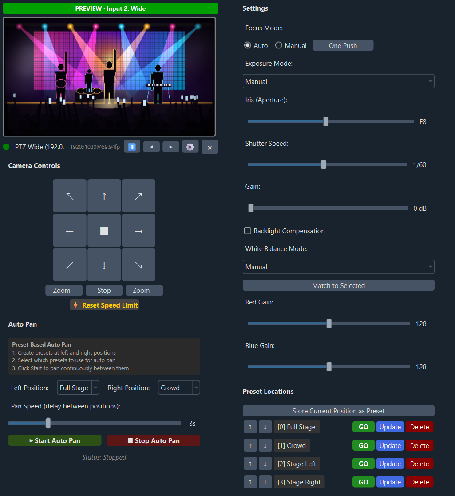
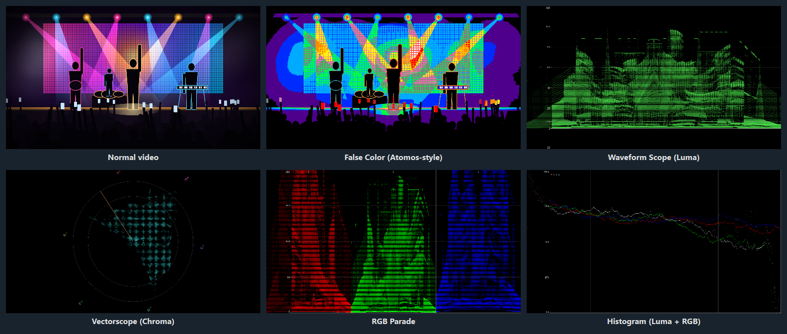
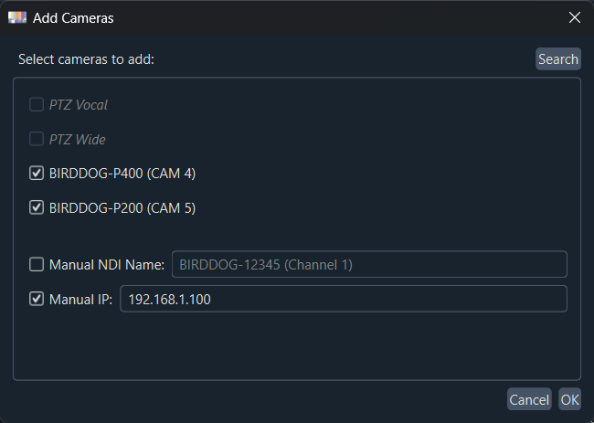
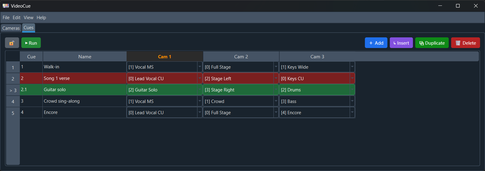
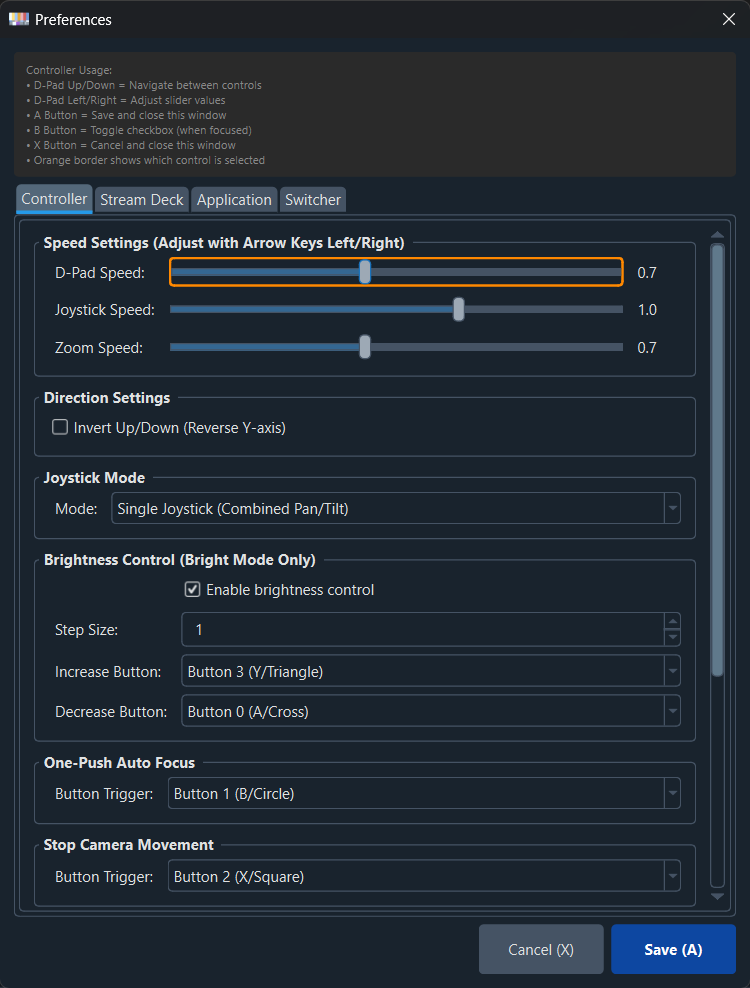
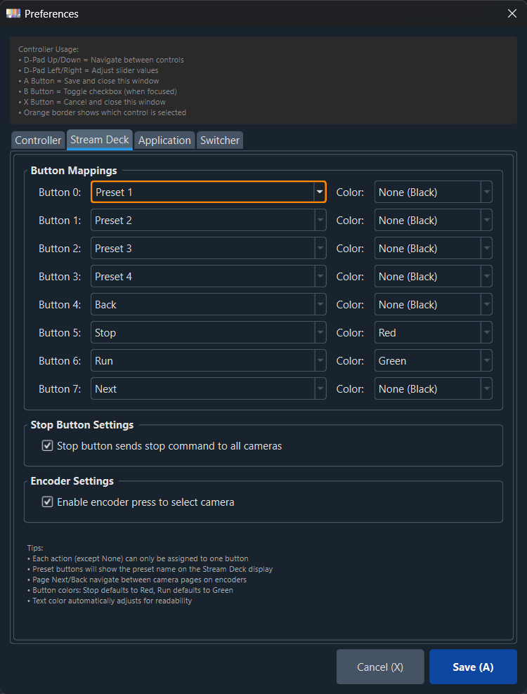
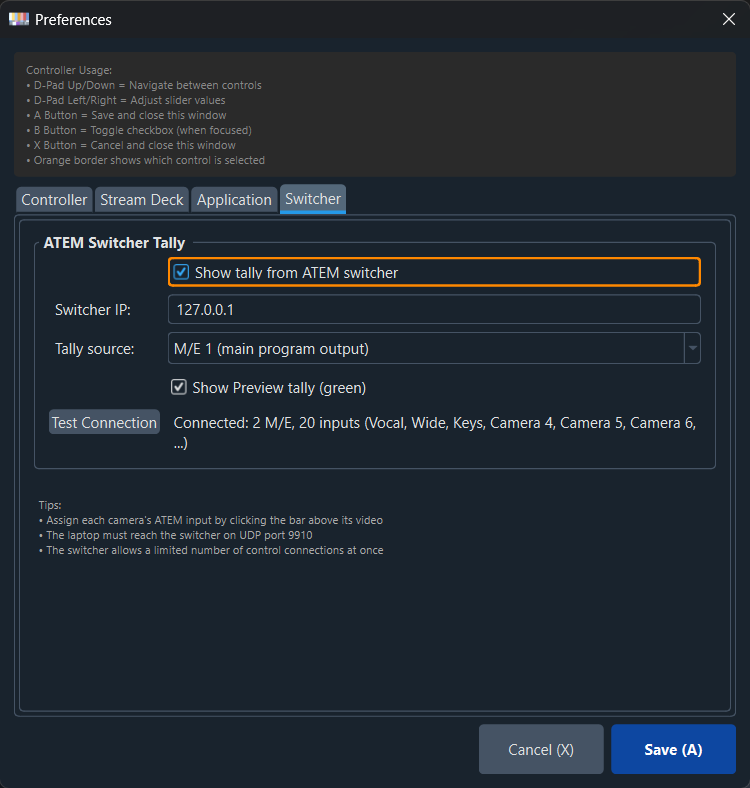

# VideoCue: Multi-Camera PTZ Control for Live Production

Run every PTZ camera in your show from one screen: watch live NDI video, recall shots instantly, fire multi-camera cues with a single keypress, and drive it all from a game controller or Stream Deck, with ATEM tally showing what's on air.



## Features

### Camera Control
- **Multi-camera Management**: Control multiple PTZ cameras side by side; click a camera to select it (orange border)
- **NDI Video Streaming**: Live preview with automatic NDI source discovery and the source resolution/frame rate shown under the video
- **VISCA-over-IP Protocol**: Industry-standard PTZ control via UDP
- **Camera Presets**: Store and recall pan/tilt/zoom positions per camera (GO / Update / Delete, reorder, double-click to rename)
- **Auto Pan**: Move continuously between two presets with an adjustable 1-10 s delay
- **Reset Speed Limit**: One click restores full pan/tilt speed if a camera has been slowed down
- **Camera Order**: ◀ / ▶ buttons move a camera left or right; ⚙ opens the camera's web page; × removes it



### Cue Tab
- **Cue Sequencing**: Dedicated Cues tab for building ordered cue rows
- **Multi-Camera Mapping**: Per-camera preset assignment in each cue row (one column per camera)
- **Cue Row Operations**: Add, Insert (after the selected row, numbered +0.1), Duplicate, Delete
- **Run Workflow**: Arm-and-run model; the armed row is green with `>`, the last run row is red
- **Fast Execution**: Run from the toolbar button, the keyboard (Space/Enter/Return), the USB controller (R3) or a Stream Deck button
- **Lock**: 🔒/🔓 locks the table during a show so cues can't be edited by accident
- **Cue Persistence**: Cue list and camera columns saved in `cues.json`

### Exposure Controls
- **5 Exposure Modes**: Auto, Manual, Shutter Priority, Iris Priority, Bright
- **Iris Control**: F-stop adjustment (F16 to F1.4)
- **Shutter Speed**: 1/10000 to 1/4 second
- **Gain Control**: 0-45 dB range
- **Brightness**: 0-41 levels (Bright mode), also on the vertical **Brt** slider next to the PTZ pad
- **Backlight Compensation**: Enable/disable

### White Balance
- **5 White Balance Modes**: Auto, Indoor (3200K), Outdoor (5600K), One Push, Manual
- **Manual Color Temperature**: Adjustable red/blue gain (0-255)
- **One Push Calibration**: Single-button white balance
- **Match to Selected**: Automatically match a camera's white balance and color to the selected camera (BirdDog P200/P400, see [Auto Color Matching](#auto-color-matching))

### Focus Controls
- **Auto Focus** with continuous tracking
- **Manual Focus** mode with Near/Far buttons (hold for continuous)
- **One Push AF**: Single autofocus operation

### Video Scopes
- **View → Scopes**: False Color (Atomos-style), Waveform (Luma), Vectorscope (Chroma), RGB Parade, Histogram (Luma + RGB)
- One scope at a time, applied to every camera's preview; the choice is remembered



### USB Game Controller Support
- **Pan/Tilt**: Analog stick or D-pad control
- **Zoom**: Trigger-based variable speed
- **Camera Switching**: Shoulder buttons (L1/R1) with auto-stop safety
- **Stop Movement**: X button to immediately halt camera movement
- **One-Push Autofocus**: B button to trigger autofocus on demand
- **Brightness Control**: Y/A buttons (configurable, Bright mode only)
- **Run Cue**: Press the right stick (R3) to run the armed cue while the Cues tab is open
- **Controller Settings**: Menu/Start button to open the Preferences dialog
- **Configurable Mappings**: Choose which button triggers focus, stop, menu and brightness
- **Speed Adjustment**: Independent speed settings for pan/tilt/zoom
- **Dual Joystick Mode**: Separate left/right stick control
- **Safe Camera Switching**: Optionally stops previous camera when switching (enabled by default)
- **Hotplug Detection**: Automatic controller connect/disconnect

### Elgato Stream Deck Plus Support
- **8 LCD Buttons**: Each button runs one action and shows its label (preset buttons show the preset name of the selected camera)
- **Button Actions**: Preset 1-8, Run, Arm, Stop, Next, Back, or None, each with an optional button color
- **Unique Action Validation**: Each action (except None) can only be assigned once
- **4 Rotary Encoders**: Each touch strip shows a camera number (orange = selected); press to select that camera, turn to change its brightness (Bright mode)
- **Camera Pages**: Next/Back page through cameras in groups of four
- **Stop**: Stops movement on all cameras (or only the selected one)
- **Clickable Icon**: Click Stream Deck icon in toolbar to open Stream Deck preferences
- **Automatic Detection**: Hotplug support with connection indicator

### ATEM Switcher Tally
- **Program/Preview Tally**: Red (Program) and green (Preview) bar above each camera's video
- **Blackmagic ATEM**: Connects over the network (UDP port 9910); read-only, never switches
- **M/E Selection**: Tally from M/E 1 (main program output, default) or M/E 2
- **Optional Preview Tally**: Preview (green) can be turned off
- **Input Assignment**: Click the tally bar to pick the camera's ATEM input (names read from the switcher)
- **Status Indicator**: ATEM icon in toolbar (green connected, red not connected, grey disabled)

### User Interface
- **Dark Theme**: Professional appearance with qdarkstyle
- **Multi-tab Layout**: Cameras tab and Cues tab
- **Scrollable Control Panel**: Camera Controls, Auto Pan, Settings and Preset Locations under each video
- **Status Indicators**: Real-time connection status with red/green indicators
- **Video Size Options**: 384×216 up to 896×504 for all previews (View → Video Size)
- **Video Performance Control**: High/Low bandwidth modes (View → Video Performance)
- **Video Format**: UYVY/BGRA/RGBA options (View → Video Format)
- **Scopes Menu**: False Color, Waveform (Luma), Vectorscope (Chroma), RGB Parade, Histogram (Luma + RGB)
- **Toolbar Status Icons**: USB controller, Stream Deck and ATEM indicators; click any of them to open its settings
- **Loading Progress**: Granular progress bar during camera initialization
- **Deferred Loading**: UI appears immediately before network connections
- **Startup Timeout Recovery**: Cameras that stall during startup are marked failed after timeout and show Reconnect
- **Play/Pause Controls**: Toggle video streaming per camera
- **Reconnect Button**: One-click reconnection for failed cameras
- **Comprehensive Error Handling**: Graceful error recovery prevents crashes
- **Automatic Settings Sync**: Camera settings (exposure, focus, white balance) queried and synced on connection
- **Update Check**: Help → Check for Updates compares your version with the latest GitHub release

### Application Settings
- **Preferences Dialog** (Edit → Preferences): Controller, Stream Deck, Application and Switcher tabs
  - **Controller Tab**: USB game controller mappings and speed settings
  - **Stream Deck Tab**: Button actions, button colors, Stop behaviour and encoder press
  - **Application Tab**: NDI video toggle and single instance mode
  - **Switcher Tab**: ATEM tally connection
  - The dialog can be driven with the game controller (D-pad to move, A = Save, X = Cancel)
- **Single Instance Mode**: Optional enforcement to prevent multiple app instances (default: enabled)
- **NDI Video Toggle**: Enable/disable NDI video streaming globally
- **File Logging**: Edit → Enable File Logging (takes effect after restart)
- **Video Performance**: Choose between High Bandwidth (max quality) or Low Bandwidth (compressed) for NDI streaming
- **Scope Mode Persistence**: Selected scope mode is saved and applied across cameras
- **Network Interface Binding**: Automatic detection and binding to correct network interface for multi-homed systems (v0.6.14+)

## Requirements

### Windows
- Python 3.10 or higher
- NDI Runtime (optional, bundled in executable)
- **Firewall**: Allow NDI Discovery Service on UDP port 5353 (mDNS) for auto-discovery

### macOS
- Python 3.10 or higher
- Install NDI Runtime from https://ndi.tv/tools/
- **Firewall**: Allow NDI Discovery Service on UDP port 5353 (mDNS) for auto-discovery

### Linux
- Python 3.10 or higher
- Install NDI Runtime:
  ```bash
  # Ubuntu/Debian
  sudo apt install libndi4
  
  # Or download from https://ndi.tv/tools/
  ```
- **Firewall**: Allow mDNS traffic on UDP port 5353 for NDI auto-discovery

## Installation

### From Source
```bash
# Clone repository
git clone https://github.com/jpwalters/VideoCue.git
cd VideoCue

# Create virtual environment (recommended)
python -m venv .venv
.venv\Scripts\activate  # Windows
source .venv/bin/activate  # macOS/Linux

# Install dependencies
pip install -r requirements.txt
```

### Dependencies
- **PyQt6**: Modern Qt6 framework for Python
- **NDI Bindings**: Bundled in `videocue/ndi_wrapper/` (compiled .pyd files)
- **pygame**: USB game controller support
- **streamdeck**: Elgato Stream Deck Plus support (with pillow for image rendering)
- **hidapi**: USB HID communication library for Stream Deck (auto-downloaded by build script)
- **qdarkstyle**: Dark theme stylesheet
- **ruff** (recommended): Fast Python linter with better accuracy than Pylint

## Running

```bash
python videocue.py
```

The application will:
1. Auto-discover NDI sources on the network
2. Detect connected USB game controllers
3. Load previously configured cameras from `%LOCALAPPDATA%\VideoCue\config.json` (Windows)

## Building Executable

### Windows (Automated)
Use the PowerShell build script for a complete build with installer:
```powershell
.\build.ps1 -Version "0.4.1"
```

This creates:
- Executable in `dist/VideoCue/` (~100-120MB with NDI Runtime)
- Inno Setup installer in `installer_output/VideoCue-{version}-Setup.exe`
- Portable ZIP in `installer_output/VideoCue-{version}-portable.zip`

### macOS (Release Workflow)
- Release tags (`v*`) now also build a macOS DMG in GitHub Actions.
- Artifact output: `installer_output/VideoCue-{version}-macOS.dmg`
- Current phase is unsigned/not notarized.

### macOS (Manual)
```bash
python -m pip install --upgrade pip setuptools
python -m pip install -r requirements-build.lock.txt
chmod +x ./build_macos.sh
./build_macos.sh --version "0.4.1"

# Optional: reuse existing dist build and only rebuild DMG
./build_macos.sh --version "0.4.1" --skip-build
```

### Linux (Release Workflow)
- Release tags (`v*`) now also build Linux installers in GitHub Actions.
- Artifact outputs:
  - `installer_output/VideoCue-{version}-x86_64.AppImage`
  - `installer_output/VideoCue-{version}-amd64.deb`
- Current phase uses an IP-only baseline if NDI runtime is unavailable.

### Linux (Manual)
```bash
python -m pip install --upgrade pip setuptools
python -m pip install -r requirements-build.lock.txt
chmod +x ./build_linux.sh
./build_linux.sh --version "0.4.1"

# Optional: reuse existing dist build and only rebuild installers
./build_linux.sh --version "0.4.1" --skip-build
```

### Manual Build
```bash
pyinstaller VideoCue.spec
```

### Build Options
```powershell
# Update version and build everything
.\build.ps1 -Version "0.4.1"

# Skip PyInstaller (use existing dist/)
.\build.ps1 -SkipBuild

# Skip Inno Setup installer
.\build.ps1 -SkipInstaller
```

### Configuration
Edit `VideoCue.spec` to update:
- Platform-specific NDI runtime search paths (`ndi_runtime_paths`)
- Application icons (`resources/icon.ico` on Windows, optional `resources/icon.icns` on macOS)

## Camera Setup

### Adding Cameras
1. On the **Cameras** tab, click **Add Camera** (top right)
2. Click **Search** to discover NDI sources (requires mDNS/port 5353 open) and tick the ones to add; cameras you already have are greyed out, or
3. Tick **Manual NDI Name** and type the exact NDI source name (for firewall-restricted networks), or
4. Tick **Manual IP** and enter the camera's IP address for IP-only control. Add `:port` if the camera does not use the default VISCA port 52381 (for example `192.168.1.100:52382`)



### Working With Cameras
- **Select**: Click anywhere on a camera; the selected camera has an orange border around its video. The USB controller and Stream Deck control the selected camera
- **Status bar** (under the video): green/red connection dot, **Reconnect** (when red), camera name and IP, video resolution, ▶/⏸ play/pause, ◀/▶ move the camera left/right, ⚙ open the camera's web page, × remove the camera
- **Pan/Tilt**: Hold one of the 8 arrow buttons; ■ stops
- **Zoom**: Hold **Zoom -** / **Zoom +**; **Stop** halts zoom
- **Reset Speed Limit**: Restores maximum pan/tilt speed if movement has become slow
- **Focus**: Auto/Manual, **One Push** autofocus, **Near**/**Far** in Manual
- **Exposure / White Balance**: Only the sliders for the chosen mode are shown (for example Iris, Shutter and Gain in Manual exposure)

### Presets
- **Store Current Position as Preset**: Asks for a name and saves the position into the next free camera memory slot
- Each preset shows `[slot] Name` with **GO** (recall), **Update** (re-save the current position to the same slot) and **Delete**
- ↑/↓ change the list order only; the camera memory slot stays the same
- Double-click a preset name to rename it

### Auto Pan
1. Store two presets (for example the left and right ends of a stage)
2. Pick them as **Left Position** and **Right Position**
3. Set **Pan Speed** (delay between positions, 1-10 s) and click **Start Auto Pan**
4. **Stop Auto Pan** stops after the current move

## Cues



1. Store presets on each camera first; the Cues tab has one **Cam** column per camera
2. Click **＋ Add** to add a row, then pick a preset for each camera in that row (leave a camera blank to leave it where it is)
3. Edit the **Cue** number (whole number or decimal, e.g. `100` or `100.1`) and **Name** by double-clicking the cell
4. **↳ Insert** adds a row after the selected one (cue number +0.1); **⧉ Duplicate** copies the selected row; **🗑 Delete** removes it
5. Click **🔓** to lock the table (**🔒**) during the show so nothing is edited by accident

**Running cues**
- The **armed** (next) cue is green and marked `>` next to its row number; double-click a row number to arm that row
- **▶ Run**, Space, Enter or Return recalls the armed cue's presets on every camera, turns that row red (last run), selects the first camera in the cue and arms the next row (wrapping to the top)
- The USB controller's R3 button and the Stream Deck **Run** button also run the armed cue, but only while the Cues tab is showing
- The column of the selected camera is highlighted orange; disconnected cameras are skipped

## Auto Color Matching

Match to Selected makes one camera's white balance and color match another, using the live NDI video from both.

1. Point both cameras at the same scene and keep them still
2. Make sure video is playing on both and scopes are off (View → Scopes)
3. Click the **reference** camera to select it
4. On the camera you want to change, click **Match to Selected** (in the White Balance settings)
5. Wait while VideoCue saves the current settings, matches white balance, then color, and verifies the result
6. Choose **Keep** or **Revert** (Cancel during matching restores the original settings)

Notes:
- Supported on BirdDog P200 and P400 cameras; the camera web API (port 8080) must be reachable
- The reference camera is never changed, and exposure is not changed
- For the most stable result, put the reference camera in Manual white balance first
- If the match can't be improved, the original settings are restored automatically

## USB Controller Configuration

### Accessing Settings
- Menu: **Edit → Preferences** (opens to the Controller tab)
- Or click the controller icon in the toolbar, or press Menu/Start on the controller



### Available Settings
- **Speed Settings**: Adjust D-pad, joystick and zoom response (0.1x to 1.5x)
- **Direction Settings**: Invert vertical axis if needed
- **Joystick Mode**: Single stick (combined) or dual stick (separate pan/tilt)
- **Brightness Control**: Enable/disable, step size, and increase/decrease buttons
- **One-Push Auto Focus / Stop Camera Movement / Preferences Menu**: Choose the button for each (or None)
- **Camera Switching**: Stop previous camera when switching (prevents runaway cameras)
- **Run on R3**: Run the armed cue by pressing the right stick (Cues tab only)

### Default Controller Mapping
- **Left Stick** (Axis 0/1): Pan/Tilt (analog)
- **D-Pad**: Pan/Tilt (digital)
- **Right Trigger** (Axis 5): Zoom in
- **Left Trigger** (Axis 4): Zoom out
- **L1/LB** (Button 4): Previous camera
- **R1/RB** (Button 5): Next camera
- **X/Square** (Button 2): **Stop camera movement** (emergency stop)
- **B/Circle** (Button 1): **One-push autofocus** (trigger quick autofocus)
- **Y/Triangle** (Button 3): Brightness increase (Bright mode)
- **A/Cross** (Button 0): Brightness decrease (Bright mode)
- **Menu/Start** (Button 7): Open Preferences
- **Right Stick press** (R3): Run the armed cue (Cues tab)

### Supported Controllers
- Xbox controllers (wired/wireless)
- PlayStation controllers (DS4, DualSense)
- Generic USB game controllers
- Any DirectInput/XInput compatible device

## Stream Deck Configuration

### Accessing Settings
- Menu: **Edit → Preferences** → **Stream Deck** tab
- Or click the Stream Deck icon in the toolbar (opens directly to Stream Deck tab)



### Button Configuration
Each of the 8 buttons can be assigned one action and a color:

| Action | What it does | Default button |
|--------|--------------|----------------|
| Preset 1-8 | Recall the 1st-8th preset of the selected camera (button shows the preset name) | Presets 1-4 on buttons 0-3 |
| Back | Previous page of cameras on the encoders | Button 4 |
| Stop | Stop movement on all cameras (or only the selected one) | Button 5 (red) |
| Run | Run the armed cue (Cues tab must be showing) | Button 6 (green) |
| Next | Next page of cameras on the encoders | Button 7 |
| Arm | Move the armed marker to the next cue without running it (Cues tab must be showing) | - |
| None | Button does nothing | - |

**Validation**: Each action (except None) can only be assigned once across all buttons

### Encoders
- The 4 encoders show 4 cameras at a time (camera numbers 1-4, then 5-8 after **Next**, and so on); the selected camera is orange
- **Press** an encoder to select that camera (can be turned off with **Enable encoder press to select camera**)
- **Turn** an encoder to change that camera's brightness (camera must be in Bright exposure mode; step size comes from the Controller tab)

## ATEM Switcher Tally



### Setup
1. **Edit → Preferences → Switcher** tab (or click the **ATEM** icon in the toolbar)
2. Check **Show tally from ATEM switcher** and enter the switcher's IP address
3. Choose the **Tally source**: M/E 1 (main program output) or M/E 2
4. Optionally uncheck **Show Preview tally**
5. Click **Test Connection** to confirm the switcher answers and lists its inputs
6. Click the bar above each camera's video and choose its ATEM input

### How Tally Is Determined
- **M/E 1**: The switcher's own tally, including keyers, downstream keyers and transitions
- **M/E 2**: Worked out from the M/E 2 Program/Preview buses, transitions and upstream keyers; downstream keyers are not included
- If M/E 2 is chosen on a single-M/E switcher, tally falls back to M/E 1 (shown in the ATEM icon tooltip)

### Testing Without a Switcher
```bash
python tools/atem_simulator.py            # fake 2-M/E ATEM on 127.0.0.1:9910
python tools/atem_tally_probe.py 127.0.0.1 # print tally from the simulator
python -m unittest tests.test_atem_tally -v
```
On site, run `python tools/atem_tally_probe.py <switcher-ip>` first to confirm the laptop can reach the switcher.

## Configuration Files

### Location
- **Windows**: `%LOCALAPPDATA%\VideoCue\`
- **macOS/Linux**: `~/.config/VideoCue/`

| File | Contents |
|------|----------|
| `config.json` | Cameras, presets and all preferences |
| `cues.json` | Cue rows and the camera-to-column mapping |
| `logs/videocue.log` | Application log (only when Edit → Enable File Logging is on) |
| `logs/videocue-crash-*.log` | Written automatically after a crash |

Settings are saved automatically when you change them. See [config_schema.json](config_schema.json) for every default value.

### Schema (abridged)
```json
{
  "cameras": [
    {
      "id": "unique-id",
      "ndi_source_name": "BIRDDOG-12345 (CAM)",
      "visca_ip": "192.168.1.100",
      "visca_port": 52381,
      "video_size": [512, 288],
      "position": 0,
      "atem_input": 1,
      "presets": [
        {"uuid": "preset-uuid", "name": "Wide Shot", "preset_number": 0}
      ]
    }
  ],
  "preferences": {
    "video_size_default": [512, 288],
    "ndi_bandwidth": "low",
    "ndi_color_format": "uyvy",
    "ndi_waveform_enabled": false,
    "ndi_video_enabled": true,
    "file_logging_enabled": false,
    "single_instance_mode": true,
    "preferred_network_interface": null
  },
  "usb_controller": {
    "dpad_speed": 0.7,
    "joystick_speed": 1.0,
    "zoom_speed": 0.7,
    "joystick_mode": "single",
    "stop_on_camera_switch": true,
    "run_cue_enabled": true
  },
  "streamdeck": {
    "encoder_press_enabled": true,
    "stop_sends_to_all_cameras": true,
    "button_0_action": "preset_1",
    "button_4_action": "page_prev",
    "button_5_action": "stop_cue",
    "button_5_color": "red",
    "button_6_action": "run_cue",
    "button_6_color": "green",
    "button_7_action": "page_next"
  },
  "atem": {
    "enabled": false,
    "ip": "192.168.10.240",
    "tally_me": 0,
    "show_preview_tally": true
  }
}
```

## VISCA Protocol

### Supported Commands
- **Camera Control**: Pan, tilt, zoom with variable speed
- **Focus**: Auto/manual mode, one-push AF
- **Exposure**: Mode selection, iris, shutter, gain, brightness
- **White Balance**: Mode selection, manual color temperature
- **Picture Quality**: Backlight compensation

### Protocol Details
- **Transport**: UDP on port 52381 (default)
- **Packet Format**: VISCA-over-IP with 8-byte header
- **Timeout**: 1 second per command
- **Connection Testing**: Uses query commands that require responses (not fire-and-forget)
- **Command Types**: 
  - Send commands: Fire-and-forget for control operations
  - Query commands: Wait for response to verify connection and sync state

### Query Support
All camera settings are queried on load to synchronize UI with camera state:
- Focus mode (Auto/Manual)
- Exposure mode and parameters (iris, shutter, gain, brightness)
- White balance mode and color temperature
- Backlight compensation status

**BirdDog Camera Support**:
- BirdDog P200/P400 cameras use non-standard VISCA response values
- Exposure BRIGHT mode: Standard VISCA=13, BirdDog=15 (both supported)
- White Balance:
  - INDOOR: Standard=1, BirdDog=6 (both supported)
  - OUTDOOR/MANUAL: BirdDog P200=5, P400=10 (firmware limitation prevents distinction)
- The app defaults to MANUAL for ambiguous values (5/10) since precise control is typically preferred

## Troubleshooting

### NDI Discovery Not Finding Cameras
- **Most Common**: Firewall blocking mDNS on UDP port 5353
  - Check Windows Firewall: Allow "NDI Discovery Service"
  - Run as admin: `Get-NetFirewallRule | Where-Object {$_.DisplayName -like "*NDI*"}`
- **Workaround**: Use manual NDI source name entry in Add Camera dialog
  - Get exact name from NDI Studio Monitor (NDI Tools)
  - Format: "BIRDDOG-12345 (Channel 1)"
- Ensure camera and computer are on same network/subnet
- Verify NDI is enabled in camera's web interface

### NDI Not Loading
- Verify NDI Runtime is installed from https://ndi.tv/tools/
- Application will continue without NDI (IP-only control available)
- Check console for NDI error messages on startup

### Camera Not Responding
- Verify IP address is correct
- Check VISCA port (usually 52381)
- Ensure no firewall blocking UDP traffic to camera
- Status indicator turns red on communication failure
- **Reconnect Options**:
  - Click the Reconnect button that appears when status is red
  - Camera controls automatically disable until connection restored

### Application Loading
- UI loads immediately, then cameras connect in background
- Progress bar shows loading status with 3 steps per camera:
  1. Creating camera widget
  2. Configuring camera settings
  3. Camera initialization completed (connected or failed)
- "Connecting..." updates status text but does not advance progress, so percentage reflects completed milestones
- Individual camera failures don't prevent other cameras from loading
- Cameras that stall during startup timeout are marked disconnected and show reconnect

### USB Controller Not Detected
- Verify controller is recognized by operating system
- Try reconnecting controller (hotplug detection every 5 seconds)
- Check pygame compatibility with your controller
- Windows may require Xbox controller drivers

### Stream Deck Not Detected
- Verify Stream Deck Plus is connected and recognized by operating system
- Check Device Manager (Windows) for "USB Input Device" entries
- Install official Elgato Stream Deck software to verify hardware functionality
- Try reconnecting device (hotplug detection active)
- Verify hidapi.dll is present in application directory (auto-downloaded by build script)
- Check console output for Stream Deck connection logs and errors
- Note: Only Stream Deck Plus (8 buttons + 4 encoders) is currently supported

### Stream Deck Buttons Not Responding
- Verify button actions are configured in preferences (Edit → Preferences → Stream Deck tab)
- Check that no duplicate actions are assigned (except None)
- Ensure camera is selected for preset-based buttons
- **Run** only works while the Cues tab is showing
- Encoder turning only changes brightness when the camera is in Bright exposure mode
- Check console output for action execution errors
- Verify encoder press is enabled if using encoders to select cameras

### Cue Does Nothing
- Switch to the Cues tab before pressing Space/Enter, R3 or the Stream Deck Run button
- Cameras that are disconnected (red) or have no preset in that row are skipped
- If a preset was deleted from a camera, pick a new one in the cue row
- Unlock the table (🔓) to edit cues

### Match to Selected Is Greyed Out or Fails
- Select (click) a different, connected camera first; that camera is the reference
- Video must be playing on both cameras and scopes must be off
- Only BirdDog P200/P400 cameras are supported, and their web API on port 8080 must be reachable
- Aim both cameras at the same, well-lit scene

### ATEM Tally Not Connecting
- Run `python tools/atem_tally_probe.py <switcher-ip>` to check reachability
- The laptop must be on a network that can reach the switcher (same subnet or routed)
- Allow outbound UDP port 9910 through firewalls
- The switcher allows a limited number of control connections; close unused ATEM Software Control/Companion sessions
- Tally bar stays grey with "No ATEM input": click it to assign the camera's ATEM input

### Video Performance Issues
- **Color Format**: **View → Video Format** menu
  - BGRA/RGBA: NDI SDK handles conversion natively (lower CPU usage)
  - UYVY: Uses NumPy conversion (higher CPU usage)
- **Bandwidth Control**: **View → Video Performance** menu
  - High Bandwidth: Maximum quality, higher network usage
  - Low Bandwidth: Lower network usage with compression (default)
- **Scopes**: **View → Scopes** menu
  - False Color, Waveform, Vectorscope, RGB Parade, and Histogram are mutually exclusive
  - Histogram (Luma + RGB) adds processing overhead similar to other analysis scopes
- **Video Size**: **View → Video Size** menu to reduce resolution
- **Pause Streams**: Use play/pause button to stop video when not needed
- Frame dropping is intentional to prevent UI lag

### Application Crashes/Errors
- **Global Exception Handler**: Unhandled errors show dialog instead of crashing
- **Crash Recovery**: After a crash VideoCue offers **Restart (With NDI)** or **Restart (Without NDI)**; a crash in the video components at startup restarts with NDI video turned off for that session
- **Error Logging**: Turn on Edit → Enable File Logging and check `logs/videocue.log`; crash logs are saved as `logs/videocue-crash-*.log` (see [Configuration Files](#configuration-files))
- **Graceful Degradation**: Most errors allow application to continue running
- **NDI Timeout**: Invalid NDI sources timeout after 5 seconds (prevents app freeze)
- If crashes continue, turn off NDI video in Edit → Preferences → Application and reconnect cameras one at a time

## Development

### Project Structure
```
videocue/
├── constants.py              # Application constants (NetworkConstants, UIConstants, etc.)
├── ui_strings.py             # Centralized UI text constants (buttons, tooltips, errors)
├── controllers/
│   ├── visca_ip.py          # VISCA protocol implementation with BirdDog support
│   ├── visca_commands.py    # VISCA command definitions and constants
│   ├── ndi_video.py         # NDI video receiver threads and scope rendering
│   ├── usb_controller.py    # USB game controller handler
│   ├── streamdeck_controller.py # Elgato Stream Deck Plus controller handler
│   ├── streamdeck_init.py   # Stream Deck initialization and discovery
│   ├── atem_tally.py        # Read-only Blackmagic ATEM tally client
│   ├── birddog_api.py       # BirdDog REST client (color settings)
│   └── color_matcher.py     # Auto color matching worker
├── models/
│   ├── config_manager.py    # JSON configuration persistence
│   ├── cue_manager.py       # Cue list persistence and row operations
│   ├── color_analysis.py    # Scene color signatures for color matching
│   └── video.py             # Video size and preset models
├── ui/
│   ├── main_window.py       # Main application window with deferred loading
│   ├── camera_widget.py     # Individual camera control widget with reconnect
│   ├── camera_add_dialog.py # Camera discovery/add dialog
│   ├── preferences_dialog.py # Multi-tab preferences (Controller, Stream Deck, Application, Switcher)
│   ├── about_dialog.py       # About dialog
│   ├── network_interface_dialog.py # Network interface selection
│   └── update_check_thread.py # Update check worker thread
└── utils/
  ├── __init__.py           # Resource path and app-data helpers
  └── network_interface.py  # Interface detection/subnet matching

resources/
├── icon.png / icon.ico       # Application icons
└── VideoCue-Screenshot.png   # README screenshot

docs/images/                  # Documentation screenshots
tests/                        # Unit tests (python -m unittest tests.test_atem_tally -v)
tools/                        # Simulators, probes and the screenshot tool

build.ps1                     # Automated PowerShell build script
config_schema.json            # Default configuration template
VideoCue.spec                 # PyInstaller build specification
requirements.txt              # Python dependencies including ruff for linting
ruff.toml                     # Ruff linter configuration
.pylintrc                     # Pylint configuration
.pyrightignore                # Pyright type checker ignore patterns
```

### Key Architectural Features
- **Deferred Initialization**: Camera connections happen after UI loads
- **Connection State Tracking**: `is_connected` flag enables/disables controls automatically
- **Query-based Testing**: Connection verification uses commands that require responses
- **Error Resilience**: Global exception handler + try-except in all critical paths
- **Progress Tracking**: Startup progress advances on completed milestones (create/configure/initialized)
- **Startup Timeout Watchdog**: Stalled camera initialization transitions to failed state with reconnect
- **Cue Execution Pipeline**: Arm/run flow with per-camera preset recalls and row auto-advance
- **Thread Safety**: 
  - NDI threads use Qt signals for cross-thread communication
  - VISCA sequence numbers protected by `_socket_lock` (prevents race conditions)
  - USB button mappings cached at init (avoids repeated config lookups)
- **Constants Module**: Centralized configuration (NetworkConstants, UIConstants, HardwareConstants, ViscaConstants)
- **UI Strings Centralization**: All user-facing text in `ui_strings.py` for consistency and future i18n
- **Camera Switch Safety**: Configurable auto-stop prevents runaway cameras when switching
- **Comprehensive Logging**: Python logging framework with optional file output to `%LOCALAPPDATA%\VideoCue\logs\videocue.log`
- **Query-based Sync**: All camera settings queried after connection to sync UI with camera state
- **Performance Optimizations**:
  - Button mapping cache eliminates repeated config lookups during event handling
  - Frame dropping via Qt signal queuing prevents UI lag during video reception
  - USB hotplug detection every 5 seconds (non-blocking polling)

### Updating Screenshots
`python tools/videocue_screenshot.py` regenerates `resources/VideoCue-Screenshot.png`; add `--docs` to also regenerate the images in `docs/images/`. It uses demo cameras, a drawn concert scene and the built-in ATEM simulator with a throwaway config, so it needs a visible desktop and UDP port 9910 free.

### Adding New Camera Parameters

When adding new VISCA commands and UI controls, follow this pattern:

1. **VISCA Protocol** (`visca_ip.py`):
   ```python
   def set_parameter(self, value: int) -> bool:
       """Set parameter description"""
       return self.send_command(f"81 01 04 XX {value:02X} FF")
   
   def query_parameter(self) -> Optional[int]:
       """Query parameter description"""
       response = self.query_command("81 09 04 XX FF")
       # Parse response (skip 16 hex chars for header)
       visca_response = response.hex().upper()[16:]
       value = int(visca_response[5], 16)
       return value
   ```

2. **UI Controls** (`camera_widget.py`):
   ```python
   # In create_controls_tree():
   self.parameter_slider = QSlider()
   self.parameter_slider.valueChanged.connect(self.on_parameter_changed)
   
   def on_parameter_changed(self, value: int):
       """Handle UI change"""
       self.parameter_label.setText(str(value))
       success = self.visca.set_parameter(value)
       self.update_status_indicator(success)
   ```

3. **Query on Load** (`camera_widget.py` in `query_all_settings()`):
   ```python
   # Block signals, query, update UI, unblock
   parameter_value = self.visca.query_parameter()
   if parameter_value is not None:
       self.parameter_slider.blockSignals(True)
       self.parameter_slider.setValue(parameter_value)
       self.parameter_slider.blockSignals(False)
       self.parameter_label.setText(str(parameter_value))
   ```

This ensures UI always reflects camera state on load without triggering unnecessary commands.

## Credits

- **VISCA Protocol**: Sony standard for PTZ camera control
- **NDI Technology**: NewTek Network Device Interface
- **PyQt6**: Qt6 Python bindings by Riverbank Computing
- **qdarkstyle**: Dark theme by Colin Duquesnoy

## License

See LICENSE file for details.

## Support

For BirdDog camera-specific features and tested configurations, refer to:
- [BirdDog User Manuals](https://www.bird-dog.tv/support/)
- VISCA protocol specifications in project documentation

Tested with:
- BirdDog P400 cameras
- BirdDog P200 cameras
- Standard VISCA-compatible PTZ cameras
